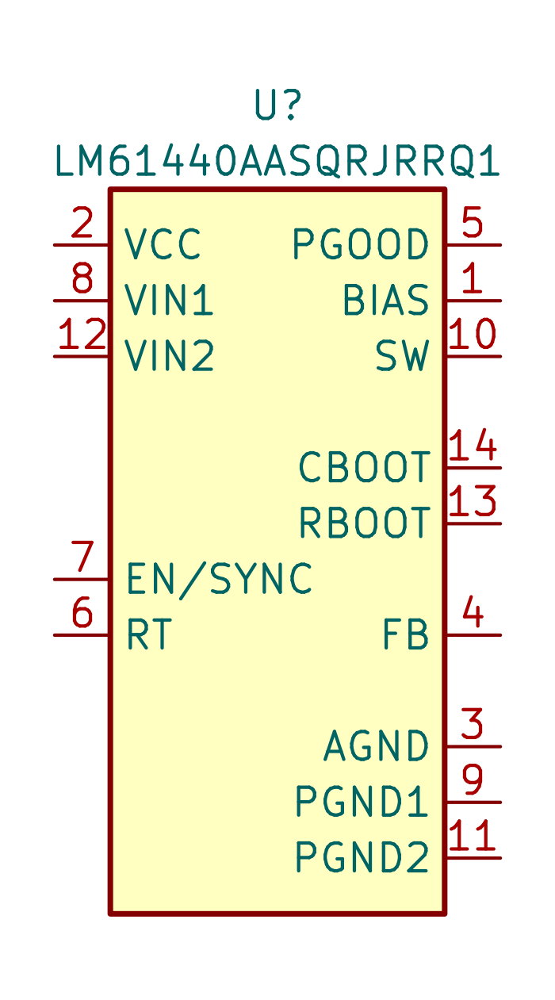
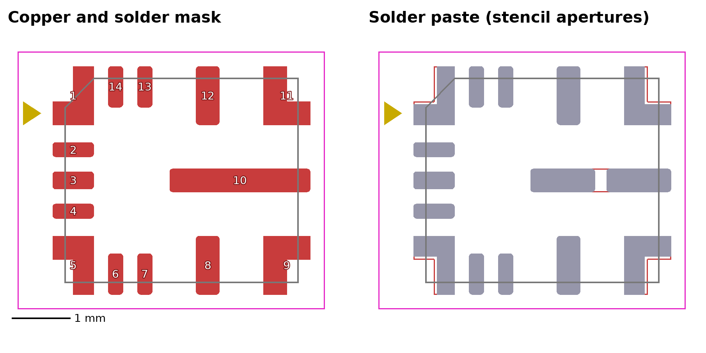
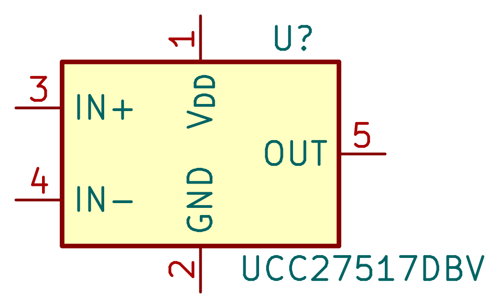
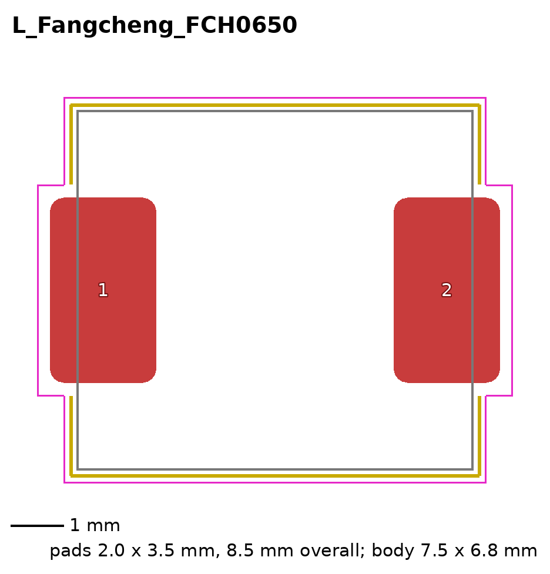

# Components

KiCad library with the symbols and footprints of the c64-mini that are not in
the standard KiCad libraries. It uses the current KiCad file formats (KiCad
10): `c64-mini.kicad_sym` for the symbols and `c64-mini.pretty/` for the
footprints.

The main board project (`hardware/main-board`) has the library registered in
its symbol and footprint library tables under the nickname `c64-mini`, with a
path relative to the project (`${KIPRJMOD}/../components/`). Other projects
under `hardware/` can register it the same way.

## Contents

| Symbol              | Footprint                                  | LCSC Part # | Notes                                                    |
| ------------------- | ------------------------------------------ | ----------- | -------------------------------------------------------- |
| `LM61440AASQRJRRQ1` | `Texas_VQFN-HR-14_4x3.5mm_P0.5mm_RJR0014A` | C3038666    | Spread spectrum, turned off while synchronized (EN/SYNC) |
| `LM61440AANRJRR`    | `Texas_VQFN-HR-14_4x3.5mm_P0.5mm_RJR0014A` | C3188034    | No spread spectrum; derived from `LM61440AASQRJRRQ1`     |
| `UCC27517DBV`       | `Package_TO_SOT_SMD:SOT-23-5`              | C99395      | Standard KiCad footprint                                 |

Footprints for parts that use a standard KiCad symbol:

| Footprint             | Symbol     | Part                                | LCSC Part # |
| --------------------- | ---------- | ----------------------------------- | ----------- |
| `L_Fangcheng_FCH0650` | `Device:L` | FCH0650-150M (15 µH power inductor) | C20415538   |

### LM61440

3 V to 36 V, 4 A synchronous step-down converter from Texas Instruments
([datasheet](https://www.ti.com/lit/ds/symlink/lm61440.pdf)). The switching
frequency is set with a resistor on RT, or synchronized to an external clock
on EN/SYNC.

The pin layout of the symbol follows the symbol in the TI Webench design, so
a Webench schematic can be copied pin by pin: supply and control pins on the
left, outputs, bootstrap, feedback and grounds on the right.

### RJR0014A footprint

TI VQFN-HR package, 14 pins, 4 mm x 3.5 mm body, 0.5 mm pitch. KiCad has no
footprint for this package. It is drawn from the LM61440 datasheet
(SNVSBD6C):

- Copper pads from the land pattern example (page 55). The L-shaped pads 1,
  5, 9 and 11 are custom pads made of two rectangles; the inner corner radius
  of the TI drawing (R0.12) is left out. The other pads have the 0.05 mm
  corner radius of the drawing.
- Solder mask: non solder mask defined, as TI prefers. The pads use the
  board's default solder mask expansion.
- Solder paste from the stencil design example (page 56). The L-shaped pads
  get a slightly narrower aperture and the SW pad (10) gets two apertures of
  1.1 mm x 0.4 mm. These are separate paste-only pads without a number.
- The pads extend 0.2 mm past the body on all sides, so the silkscreen only
  has a pin 1 marker and no body outline. The body outline is on the
  fabrication layer.
- There is no 3D model.

### UCC27517

Single-channel, low-side gate driver from Texas Instruments
([datasheet](https://www.ti.com/lit/ds/symlink/ucc27517.pdf)) with 4 A peak
source and sink current and a 4.5 V to 18 V supply. Its input thresholds are
TTL and CMOS compatible and do not depend on the supply voltage, so a 5 V
logic signal can switch a 12 V output. The output is held low while VDD is
below the undervoltage lockout threshold or an input is floating.

KiCad has a symbol for the UCC27511A, but that part has split outputs and a
different pinout (SOT-23-6). The `UCC27517DBV` symbol is drawn in the same
style, with the pins from the pin functions table of the datasheet (SLUSAY4D):
1 VDD, 2 GND, 3 IN+, 4 IN-, 5 OUT. For a noninverting driver, connect IN- to
GND; for an inverting driver, connect IN+ to VDD. It uses the standard KiCad
footprint `Package_TO_SOT_SMD:SOT-23-5`.

### FCH0650 footprint

Molded, shielded power inductor from Fangcheng Electronics
([datasheet](https://datasheet.lcsc.com/datasheet/pdf/59e676df66a25ab3384f72137df98d14.pdf?productCode=C20415538)).
The FCH0650-150M (15 µH, 54 mΩ typical, 5.5 A saturation current, 5 A rated
current) is the inductor of the 5 V buck converter. KiCad has no footprint for
this package; `Inductor_SMD:L_Changjiang_FXL0650` comes close, but is drawn
for a smaller body.

- Pads from the land pattern recommendation in the datasheet: two pads of
  2.0 mm x 3.5 mm, 8.5 mm over the outer edges. The terminals of the part are
  1.6 mm x 3.0 mm.
- Body outline on the fabrication layer at the maximum body size of
  7.5 mm x 6.8 mm, and on the silkscreen 0.11 mm outside it, interrupted next
  to the pads.
- Courtyard 0.25 mm around the body and the pads.
- There is no 3D model.

## Adding parts

- Use the KiCad 10 formats, not the legacy `.lib` format.
- Take footprints from the land pattern in the manufacturer's datasheet, and
  write down the source (document number and page) in the footprint
  description and in this README.
- Fill in the datasheet link, the description and the `LCSC Part #` field,
  the field name the main board uses.
- Check the pin numbers of the symbol against the footprint and the
  datasheet.
