# Components

KiCad library with the symbols and footprints of the c64-mini that are not in
the standard KiCad libraries. It uses the current KiCad file formats (KiCad
10): `c64-mini.kicad_sym` for the symbols and `c64-mini.pretty/` for the
footprints.

The main board project (`hardware/main-board`) has the library registered in
its symbol and footprint library tables under the nickname `c64-mini`, with a
path relative to the project (`${KIPRJMOD}/../components/`). Other projects
under `hardware/` can register it the same way.

## Contents

| Symbol              | Footprint                                  | LCSC Part # | Notes                                                    |
| ------------------- | ------------------------------------------ | ----------- | -------------------------------------------------------- |
| `LM61440AASQRJRRQ1` | `Texas_VQFN-HR-14_4x3.5mm_P0.5mm_RJR0014A` | C3038666    | Spread spectrum, turned off while synchronized (EN/SYNC) |
| `LM61440AANRJRR`    | `Texas_VQFN-HR-14_4x3.5mm_P0.5mm_RJR0014A` | C3188034    | No spread spectrum; derived from `LM61440AASQRJRRQ1`     |
| `UCC27517DBV`       | `Package_TO_SOT_SMD:SOT-23-5`              | C99395      | Standard KiCad footprint                                 |
| `RP2354B`           | `QFN-80-1EP_10x10mm_P0.4mm_EP3.4x3.4mm_ThermalVias_0.3mm` | C39843328 | Supervisor microcontroller; pin layout differs from KiCad's stock symbol |
| `MD-40SM`           | `Mini-DIN-4_CUI_MD-40SM_Horizontal`        | C6224745    | S-Video socket; stock `Connector:Mini-DIN-4` plus a shield pin |
| `CAX-AV-314-RWY-PHP` | `Jack_RCA_x3_CAX_AV-314-RWY_Horizontal` | C55072367 | Triple RCA jack (red, white, yellow); one unit per jack |
| `6510`              | `Package_DIP:DIP-40_W15.24mm_Socket`       | C2874018    | MOS 6510 CPU (also 8500); LCSC part is the DIP-40 socket |
| `VIC-II`            | `Package_DIP:DIP-40_W15.24mm_Socket`       | C2874018    | MOS 6567/8562 VIC-II; LCSC part is the DIP-40 socket |
| `SID`               | `Package_DIP:DIP-28_W15.24mm_Socket`       | C2874016    | MOS 6581/8580 SID; LCSC part is the DIP-28 socket |
| `C64_Expansion_Port` | `KU-14194HB-RevB-KiCad:EXPANSION_PORT`    |             | C64 expansion (cartridge) port, 2x22 contacts |
| `C64_Cassette_Port` | `C64_Cassette_Port_Edge_2x06_P3.96mm`      |             | C64 cassette port, 2x6 edge fingers on the board |
| `C64_User_Port`     | `C64_User_Port_Edge_2x12_P3.96mm`          |             | C64 user port, 2x12 edge fingers on the board |

Footprints for parts that use a standard KiCad symbol:

| Footprint             | Symbol     | Part                                | LCSC Part # |
| --------------------- | ---------- | ----------------------------------- | ----------- |
| `L_Fangcheng_FCH0650` | `Device:L` | FCH0650-150M (15 µH power inductor) | C20415538   |
| `L_Abracon_AOTA-B201610` | `Device:L` | AOTA-B201610S3R3-101-T (3.3 µH, polarity marked; RP2350/RP2354 core regulator) | C42411119 |
| `QFN-80-1EP_10x10mm_P0.4mm_EP3.4x3.4mm_ThermalVias_0.3mm` | `RP2354B` (this library) | RP2354B (also RP2350B) | C39843328 |
| `USB_C_Receptacle_HCTL_HC-TYPE-C-16P-01A_Aligned` | `Connector:USB_C_Receptacle_USB2.0_16P` | HCTL HC-TYPE-C-16P-01A | C2894897 |
| `microSD_Hroparts_TF-01A` | `Connector:Micro_SD_Card_Det1` | Korean Hroparts Elec TF-01A (push-push micro SD socket) | C91145 |
| `DIN-6_Minlenda_MLD-DS-6-03-08_Horizontal` | `Connector:DIN-6` | Minlenda MLD-DS-6-03-08 (6-pin DIN socket, right angle; also CAX DIN-603-H) | C53056242 |

Two of these footprints are modified copies of footprints from the KiCad
library (`QFN-80-1EP_10x10mm_P0.4mm_EP3.4x3.4mm_ThermalVias` and
`USB_C_Receptacle_HCTL_HC-TYPE-C-16P-01A`), which are licensed under
[CC-BY-SA 4.0](https://creativecommons.org/licenses/by-sa/4.0/) with the
KiCad library exception for designs that use them. The modified files keep
that licence; their descriptions name the original footprint.
The `MD-40SM` symbol is likewise a modified copy of KiCad's
`Connector:Mini-DIN-4` symbol and keeps the same licence.

### LM61440

3 V to 36 V, 4 A synchronous step-down converter from Texas Instruments
([datasheet](https://www.ti.com/lit/ds/symlink/lm61440.pdf)). The switching
frequency is set with a resistor on RT, or synchronized to an external clock
on EN/SYNC.

The pin layout of the symbol follows the symbol in the TI Webench design, so
a Webench schematic can be copied pin by pin: supply and control pins on the
left, outputs, bootstrap, feedback and grounds on the right.

### RJR0014A footprint

TI VQFN-HR package, 14 pins, 4 mm x 3.5 mm body, 0.5 mm pitch. KiCad has no
footprint for this package. It is drawn from the LM61440 datasheet
(SNVSBD6C):

- Copper pads from the land pattern example (page 55). The L-shaped pads 1,
  5, 9 and 11 are custom pads made of two rectangles; the inner corner radius
  of the TI drawing (R0.12) is left out. The other pads have the 0.05 mm
  corner radius of the drawing.
- Solder mask: non solder mask defined, as TI prefers. The pads use the
  board's default solder mask expansion.
- Solder paste from the stencil design example (page 56). The L-shaped pads
  get a slightly narrower aperture and the SW pad (10) gets two apertures of
  1.1 mm x 0.4 mm. These are separate paste-only pads without a number.
- The pads extend 0.2 mm past the body on all sides, so the silkscreen only
  has a pin 1 marker and no body outline. The body outline is on the
  fabrication layer.
- There is no 3D model.

### UCC27517

Single-channel, low-side gate driver from Texas Instruments
([datasheet](https://www.ti.com/lit/ds/symlink/ucc27517.pdf)) with 4 A peak
source and sink current and a 4.5 V to 18 V supply. Its input thresholds are
TTL and CMOS compatible and do not depend on the supply voltage, so a 5 V
logic signal can switch a 12 V output. The output is held low while VDD is
below the undervoltage lockout threshold or an input is floating.

KiCad has a symbol for the UCC27511A, but that part has split outputs and a
different pinout (SOT-23-6). The `UCC27517DBV` symbol is drawn in the same
style, with the pins from the pin functions table of the datasheet (SLUSAY4D):
1 VDD, 2 GND, 3 IN+, 4 IN-, 5 OUT. For a noninverting driver, connect IN- to
GND; for an inverting driver, connect IN+ to VDD. It uses the standard KiCad
footprint `Package_TO_SOT_SMD:SOT-23-5`.

### FCH0650 footprint

Molded, shielded power inductor from Fangcheng Electronics
([datasheet](https://datasheet.lcsc.com/datasheet/pdf/59e676df66a25ab3384f72137df98d14.pdf?productCode=C20415538)).
The FCH0650-150M (15 µH, 54 mΩ typical, 5.5 A saturation current, 5 A rated
current) is the inductor of the 5 V buck converter. KiCad has no footprint for
this package; `Inductor_SMD:L_Changjiang_FXL0650` comes close, but is drawn
for a smaller body.

- Pads from the land pattern recommendation in the datasheet: two pads of
  2.0 mm x 3.5 mm, 8.5 mm over the outer edges. The terminals of the part are
  1.6 mm x 3.0 mm.
- Body outline on the fabrication layer at the maximum body size of
  7.5 mm x 6.8 mm, and on the silkscreen 0.11 mm outside it, interrupted next
  to the pads.
- Courtyard 0.25 mm around the body and the pads.
- There is no 3D model.

### RP2354 microcontroller

The supervisor microcontroller (#46) is an RP2354B: an RP2350B with 2 MB of
flash in the package, in QFN-80
([datasheet](https://datasheets.raspberrypi.com/rp2350/rp2350-datasheet.pdf)).

KiCad 10 has `MCU_RaspberryPi:RP2354B` in its standard library, but this
library has its own `RP2354B` symbol with a different pin layout, carried
over from the author's earlier RP2354 designs:

- **Top:** the supplies (DVDD, QSPI_IOVDD, IOVDD, USB_OTP_VDD, ADC_AVDD).
- **Left:** the core regulator, QSPI, crystal, RUN and SWD pins.
- **Right:** USB and GPIO0 to GPIO47 in order.
- **Bottom:** GND (the exposed pad, pin 81).

Its pin names and numbers match the RP2350 datasheet and KiCad's stock
symbol. The only differences are the spelling of a few names: `SWD` for
SWDIO, `QSPI_SS` without the active-low bar, and `GPIO40_ADC0` for
`GPIO40/ADC0`. Power pins are power inputs and `VREG_LX` is a power output,
so ERC checks the supplies. Because the core supply (DVDD, `VREG_FB`) is fed
through the inductor, which is passive, that net needs a PWR_FLAG.

The symbol uses the footprint below, with 0.3 mm thermal vias.

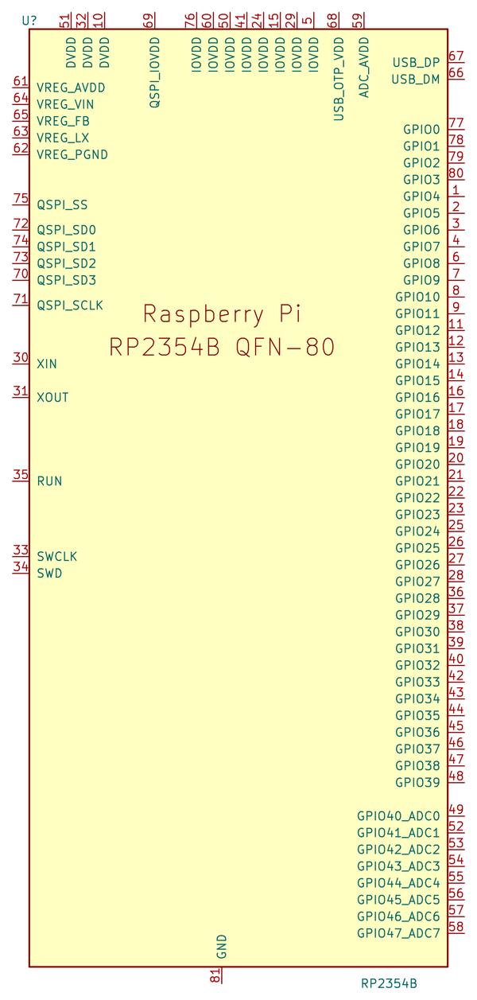

### QFN-80 footprint with 0.3 mm thermal vias

`QFN-80-1EP_10x10mm_P0.4mm_EP3.4x3.4mm_ThermalVias_0.3mm` is KiCad's
`QFN-80-1EP_10x10mm_P0.4mm_EP3.4x3.4mm_ThermalVias` with the nine thermal
vias in the exposed pad enlarged from 0.2 mm to 0.3 mm drill (0.5 mm to
0.6 mm diameter). 0.3 mm is the smallest drill that common PCB fabs make at
their standard price. All other pads, the paste pattern, the outlines and the
3D model are unchanged.

### AOTA-B201610 footprint

The core voltage regulator of the RP2350 and RP2354 needs a 3.3 µH inductor
that is mounted the right way round: the field of the inductor couples into
the regulator's control loop (RP2350 datasheet, section 6.3.8.3). Raspberry
Pi and Abracon made the AOTA-B201610S3R3-101-T for this, with a polarity dot
on the top and all parts on the reel in the same orientation.

- Pads from the recommended land pattern in the datasheet
  ([AOTA-B201610S3R3-101-T](https://datasheet.lcsc.com/datasheet/pdf/0ca6a1bbc70fd13a89f7695ff7dd8558.pdf?productCode=C42411119),
  Rev. A, page 4): two pads of 1.0 mm x 1.6 mm with a 1.0 mm gap.
- **Pad 1 is the terminal next to the polarity dot.** The silkscreen shows a
  dot above pad 1, and the fabrication layer shows the body (2.0 mm x 1.6 mm)
  with the dot as it is printed on the part.
- **Connection:** pad 1 (dot) goes to the regulator output (`DVDD`, with
  `VREG_FB`), pad 2 to `VREG_LX`. This matches the reference layout in the
  RP2350 datasheet (Figure 26), where the orientation indicator sits on the
  terminal towards the output capacitor. Follow that layout as closely as
  possible.
- Use the symbol `Device:L` and keep its pin 1 on the `DVDD` side.
- There is no 3D model.

### Aligned USB-C footprint

`USB_C_Receptacle_HCTL_HC-TYPE-C-16P-01A_Aligned` has the same pads as the
KiCad footprint `USB_C_Receptacle_HCTL_HC-TYPE-C-16P-01A`, but everything is
moved 1.15 mm towards the mating face of the connector. Its origin then
matches the placement origin that the assembly data for this part (LCSC
C2894897) uses, so the component position file needs no correction. The 3D
model reference has a matching offset of -1.15 mm.

### MD-40SM mini-DIN socket

The CUI (now Same Sky) MD-40SM is a right-angle, through-hole 4-pin mini-DIN
socket with a metal shield, used as the S-Video connector
([MD-SM datasheet](https://www.sameskydevices.com/product/resource/md-sm.pdf),
rev. 1.09). KiCad has no footprint for it.

**Symbol:** `MD-40SM` is KiCad's `Connector:Mini-DIN-4` with a shield pin
added. The stock symbol only has the four contacts, so the shield could not
be connected. Pins 1 to 4 are numbered as in the datasheet and drawn as seen
from the front of the socket (1 bottom right, 2 bottom left, 3 top right, 4
top left). `SH` is the shield and the earth terminal; connect it to ground.

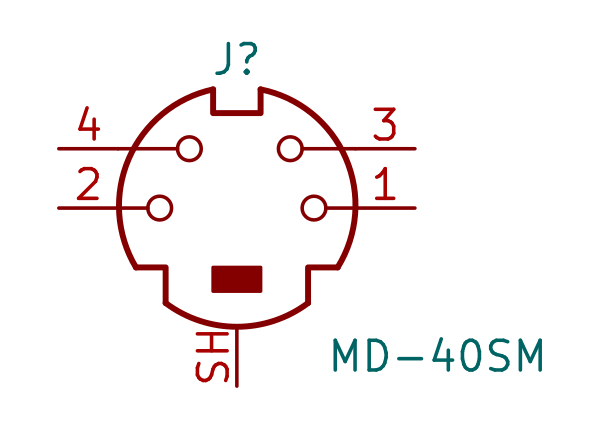

**Footprint:** `Mini-DIN-4_CUI_MD-40SM_Horizontal`, from the recommended PCB
layout for **date codes after 3 March 2022** (datasheet page 2). The layout
for older parts is different (6.5 mm pin pitch, plastic pegs instead of
shield legs) and does not fit this footprint. The origin is pad 1.

- Contacts: 6.8 mm apart, pins 1 and 2 8.5 mm from the board edge, pins 3
  and 4 11.0 mm from the board edge. The datasheet asks for 0.9 mm holes
  (+0.1/-0); the footprint uses 1.0 mm holes with 1.6 mm pads.
- Earth terminal (`SH`): a 2.2 mm x 0.7 mm slot (+0.1/-0) in the datasheet,
  4.7 mm from the board edge; the footprint uses a 2.3 mm x 0.8 mm plated
  slot.
- Shield legs (`SH`): 13.5 mm apart, 5.5 mm from the board edge. The
  datasheet does not give the slot size; the legs are about 0.55 mm x 2.0 mm
  in the drawing, and the front view puts them slightly further apart than
  13.5 mm. The footprint uses 1.0 mm x 2.4 mm plated slots, which leave room
  for both.
- The mating face sits on the board edge, which is marked on the `Dwgs.User`
  layer.
- Fabrication layer: the housing (14 mm x 12.6 mm). Courtyard 0.5 mm around
  the housing, the latch on its back and the pads.
- There is no 3D model.

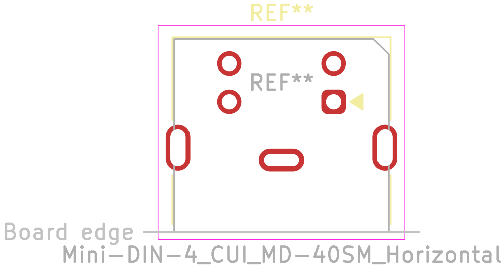

### DIN-6 socket

The serial port (J1601) uses a full-size 6-pin DIN socket with the 240° pin
layout of DIN 45322 and a centre pin, right angle and through hole (#147).
KiCad has no footprint for a full-size DIN socket (`Connector_DIN` only has
DIN 41612 connectors). The footprint
`DIN-6_Minlenda_MLD-DS-6-03-08_Horizontal` is for the Minlenda
MLD-DS-6-03-08 (C53056242,
[datasheet](https://datasheet.lcsc.com/datasheet/pdf/83857c2ae8e46b673d2bd5467c14fb47.pdf?productCode=C53056242),
drawing MLD-2509031032 rev. A/0). The CAX DIN-603-H (C54573054) has the same
drawing and fits too. The other right-angle 6-pin "DIN" sockets at LCSC
(checked November 2026) are mini-DIN.

- **Source:** the recommended PCB layout ("PCB板安装孔图"), seen from the
  component side with the front of the socket at the bottom. This matches
  the front view: pin 3 top left, 1 top right, 5 and 4 below them, 2 at the
  bottom and 6 in the centre, the standard DIN numbering.
- **Contacts:** pins 3, 2 and 1 in a row 15 mm wide, 12 mm behind the front
  face; 5 and 4 10 mm apart, 14.5 mm behind it; 6 in the centre, 17.1 mm
  behind it. The origin is pin 1.
- **Front legs:** 10 mm apart, 2.5 mm behind the front face. They are the
  socket's ground contact, so they are numbered 2, the DIN ground pin, as in
  the upstream footprint. KiCad's `Connector:DIN-6` symbol then needs no
  extra pin.
- **Holes:** 1.5 mm, as in the datasheet, with 2.5 mm pads.
- **Other layers:** the front face sits on the board edge, marked on
  `Dwgs.User`. Fabrication layer: the body (21 mm x 18.8 mm with the 1.8 mm
  front plate) and the pin numbers. Courtyard 0.5 mm around the body.
- There is no 3D model.

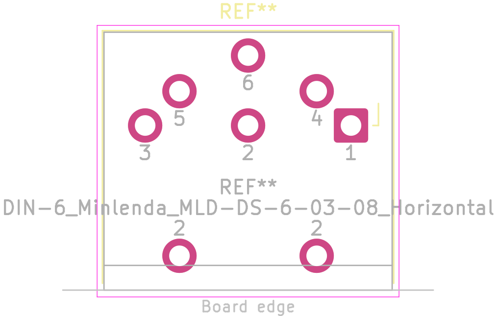

### Triple RCA jack

The CAX-AV-314-RWY-PHP is a horizontal, through-hole block of three RCA
(cinch) jacks with red, white and yellow inserts
([drawing](https://datasheet.lcsc.com/datasheet/pdf/144f434e9a18d89afabc6990ecca74fc.pdf?productCode=C55072367),
Rev. A). KiCad has no footprint for it.

**Symbol:** `CAX-AV-314-RWY-PHP` has one unit per jack, drawn like
`Connector:Conn_Coaxial`, so each jack can be placed next to its own circuit.
The pin numbers follow the schematic in the drawing:

| Unit | Jack   | Centre contact | Shield |
| ---- | ------ | -------------- | ------ |
| A    | Red    | 1              | 2      |
| B    | White  | 3              | 4      |
| C    | Yellow | 5              | 6      |

Seen from the front, the jacks are red, white and yellow from left to right.
All pins are passive.

**Footprint:** `Jack_RCA_x3_CAX_AV-314-RWY_Horizontal`, from the PCB layout
(top view) in the drawing. The origin is pad 1.

- The jacks are 14 mm apart. The pins of each jack are 3.75 mm to the left of
  its axis.
- The centre contacts (1, 3, 5) are in the back row, 12.8 mm from the board
  edge, with 1.5 mm holes (2.5 mm pads). The shields (2, 4, 6) are in the
  front row, 5.5 mm from the board edge, with 1.8 mm holes (3.0 mm pads).
- The two plastic locating tabs go into non-plated slots of 2 mm x 3 mm,
  38.3 mm apart and 8.7 mm from the board edge. The drawing shows them as
  rectangles; KiCad slots have round ends.
- The front of the housing sits on the board edge, which is marked on the
  `Dwgs.User` layer. The front view of the drawing has a 1.6 mm step below
  the seating plane at the front, which fits over the edge of a 1.6 mm board.
  The sockets stick out 8 mm past the edge.
- Fabrication layer: the housing (41 mm wide) and the sockets. Courtyard
  0.5 mm around the housing, the pads and the sockets.
- There is no 3D model.

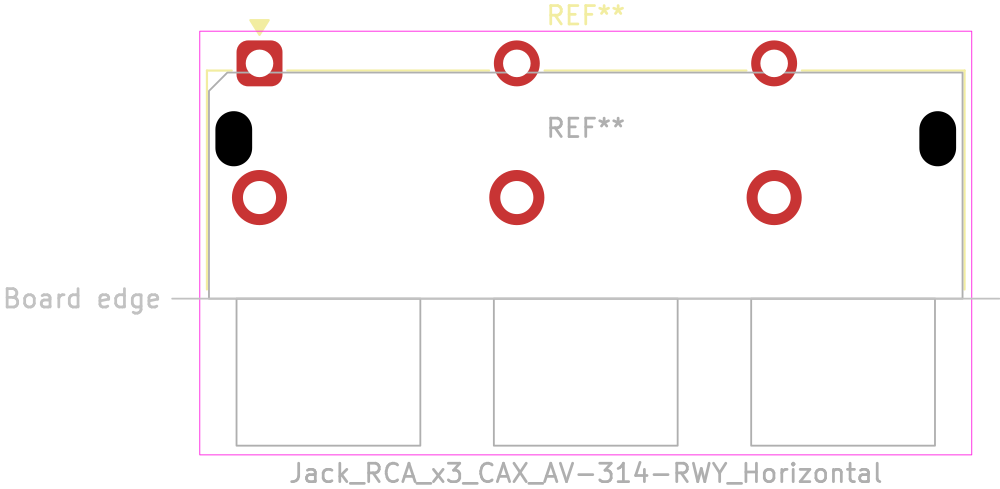

### TF-01A micro SD socket

The Korean Hroparts Elec TF-01A is a push-push micro SD (TF) socket, 1.85 mm
high, with a card detect contact, for the SD card slot on the supervisor
(#95). KiCad has no footprint for it; the micro SD footprints in
`Connector_Card` are for Hirose, Molex and Würth sockets with other pad
positions.

**Symbol:** use KiCad's `Connector:Micro_SD_Card_Det1`. Its pins match the
pad numbers of the footprint:

| Pad | Drawing | Symbol pin | SD mode | SPI mode |
| --- | ------- | ---------- | ------- | -------- |
| 1   | 1       | DAT2       | DAT2    | (unused) |
| 2   | 2       | DAT3/CD    | DAT3    | CS       |
| 3   | 3       | CMD        | CMD     | MOSI     |
| 4   | 4       | VDD        | VDD     | VDD      |
| 5   | 5       | CLK        | CLK     | SCK      |
| 6   | 6       | VSS        | VSS     | VSS      |
| 7   | 7       | DAT0       | DAT0    | MISO     |
| 8   | 8       | DAT1       | DAT1    | (unused) |
| 9   | Cd      | DET        | Card detect | Card detect |
| SH  | Shell (four pads) | SHIELD | Ground | Ground |

The card detect contact (`Cd`) is a switch against the shell. The drawing
does not say whether it closes or opens when a card is inserted; check this
on a sample before the firmware relies on it.

**Footprint:** `microSD_Hroparts_TF-01A`, from the PCB layout (pattern side)
in the manufacturer's drawing
([TF-01A](https://datasheet.lcsc.com/datasheet/pdf/7650eac21a54674b08ad4ba21e17fceb.pdf?productCode=C91145),
Rev. A, 2014-09-29). The origin is the centre of the body (14.80 mm x
13.79 mm), as usual for SMD footprints in KiCad; check the position against
the assembly preview.

- **Signal pads:** nine pads of 0.70 mm x 1.30 mm at 1.10 mm pitch, `Cd`
  first and then card contacts 8 to 1, 8.80 mm from `Cd` to pin 1. Their
  rear edge is 1.00 mm behind the back of the body.
- **Shell pads (`SH`):** two rear pads of 1.20 mm x 1.40 mm, 1.10 mm outside
  `Cd` and 13.58 mm from it, 1.50 mm in front of the rear edge of the signal
  pads. Two front pads of 1.20 mm x 2.00 mm, 15.52 mm apart and 9.70 mm in
  front of the rear shell pads.
- **Locating pegs:** two non-plated holes of 1.00 mm for the 0.80 mm pegs,
  8.00 mm apart, the first 2.81 mm from the centre of the left shell pads. The PCB layout does not
  give their position from front to back; the bottom view puts them 10.49 mm
  in front of the back of the body, 0.29 mm in front of the front shell pads.
- **Board edge:** the card sticks out 2.65 mm past the front of the housing
  in the locked position, and has to be pushed in to eject it. Place the
  socket with the front of the housing at the board edge, which is marked on
  the `Dwgs.User` layer. The card is shown dashed on the fabrication layer.
- **Outlines:** the body on the fabrication layer, with the step in its
  front edge. The silkscreen is 0.11 mm outside the body and stays clear of
  the pads; a triangle behind pad 1 marks pin 1. Courtyard 0.25 mm around the
  pads and the body.
- There is no 3D model.

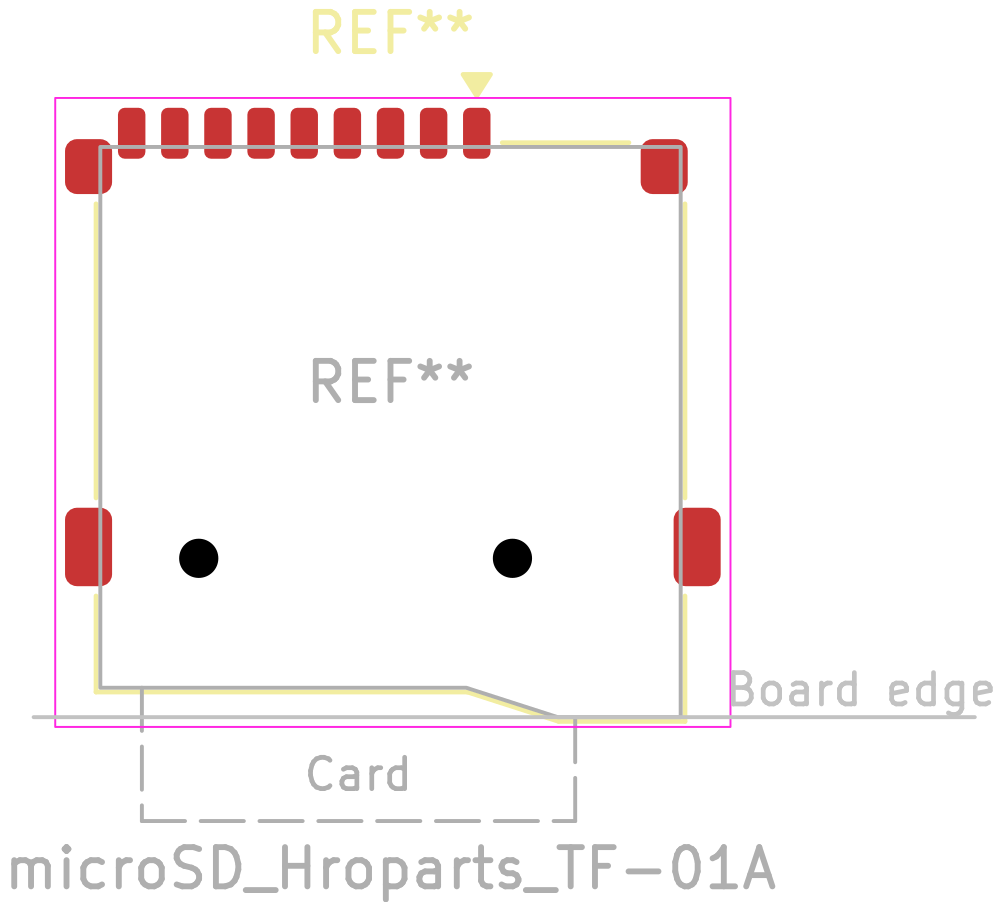

### 6510, VIC-II and SID

Symbols for the three MOS chips of the C64 that KiCad does not have: the CPU
(`6510`), the video controller (`VIC-II`) and the sound chip (`SID`). They
replace the symbols of the original design (the `KU-schematics-library` of
the upstream replica) on the main board (#139).

- **Pin positions:** the same as the upstream symbols, so that the main
  board's sheets kept their wiring. The pins are on a 1.27 mm grid, not
  KiCad's usual 2.54 mm, for the same reason.
- **Pin names:** from the MOS datasheets
  ([6510](http://www.6502.org/documents/datasheets/mos/mos_6510_mpu.pdf),
  [6567 VIC-II](http://www.6502.org/documents/datasheets/mos/mos_6567_vic_ii_preliminary.pdf),
  [6581 SID](http://www.6502.org/documents/datasheets/mos/mos_6581_sid.pdf)),
  with overbars for active-low signals and `PHI` for the clocks.
- **Pin types:**
  - 6510: A0 to A15 and R/~W are tri-state outputs (AEC turns them off), D0
    to D7 and P0 to P5 bidirectional, PHI2 an output, the rest inputs.
  - VIC-II: D0 to D7 and the multiplexed A0/A8 to A5/A13 are bidirectional
    (the 6510 selects a register on A0 to A5), D8 to D11 inputs (colour
    data), A6 to A11 tri-state outputs. `~IRQ` and SYNC/LUM are open drain
    and COLOR is open source, as in the datasheet; `BA`, `AEC`, PHI0, `~RAS`
    and `~CAS` are outputs.
  - SID: D0 to D7 and POTX/POTY are bidirectional, CAP1A to CAP2B passive,
    AUDIO_OUT open source (it needs an external load to ground), the rest
    inputs.
- **Variants:** the same pinouts fit the later HMOS-II parts: the 8500 for
  the 6510, the 8562 (NTSC) and 8565 (PAL) for the VIC-II, the 8580 for the
  SID. Only the supply on the VIC-II's VDD (pin 13: 12 V on the 6567/6569,
  5 V on the 8562/8565) and the SID's VDD (pin 28: 12 V on the 6581, 9 V on
  the 8580) differs; the Value field names the fitted part.
- **Footprint:** KiCad's DIP socket footprints. The LCSC numbers are those of
  the round-pin sockets; the chips themselves come from elsewhere.

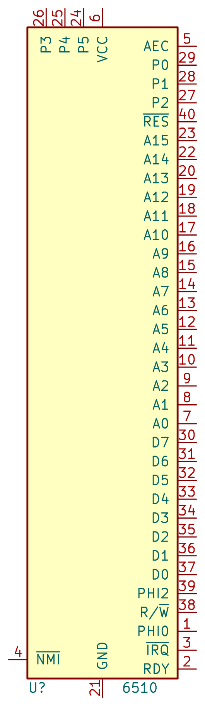
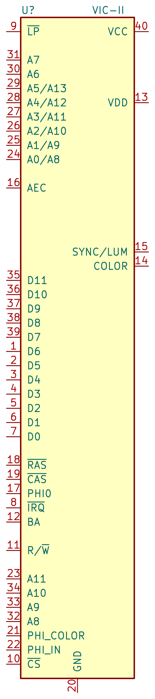
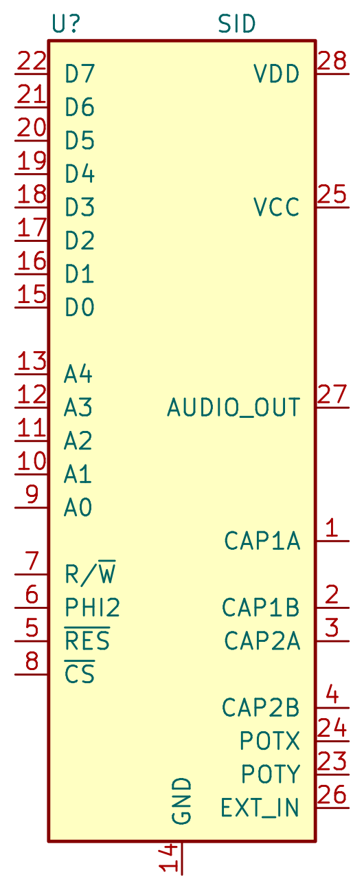

### C64 expansion, cassette and user port

Symbols for the three C64 ports on the main board: `C64_Expansion_Port`
(J201), `C64_Cassette_Port` (J202) and `C64_User_Port` (J1602). They replace
the symbols of the original design (the `KU-schematics-library` of the
upstream replica) (#115).

- **Pin positions and numbers:** the same as the upstream symbols, so the
  main board's sheets kept their wiring; like the upstream symbols, they are
  on a 1.27 mm grid. The pin numbers match the pad numbers of the
  footprints: 1 to 22 and A to Z on the expansion port, 1 to 12 and A to N
  on the user port, and `A,1` to `F,6` on the cassette port, whose top and
  bottom contacts are joined.
- **Pin names:** the C64 signal names of each contact, with overbars for
  active-low signals. On the user port, pins 10 and 11 carry 9 V AC on a C64
  and are named NC, because the c64-mini leaves them unconnected (#37).
- **Pin types:** passive, as usual for connectors.

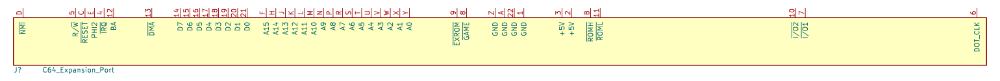
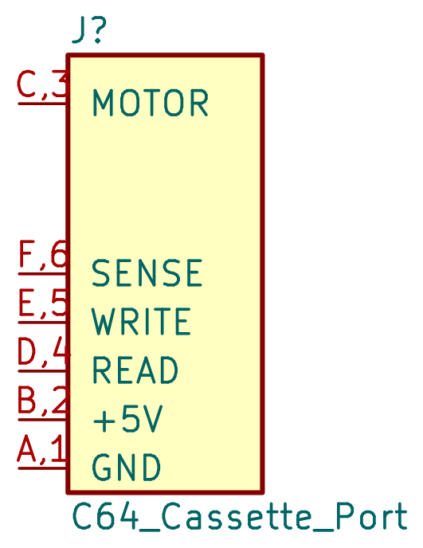
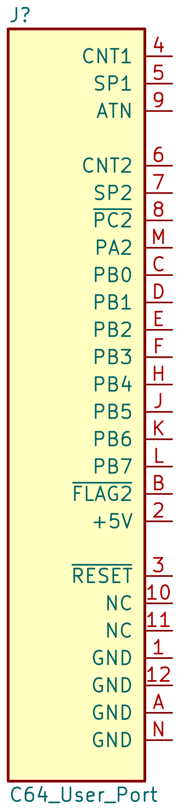

### C64 cassette and user port edge fingers

The cassette port (J202) and the user port (J1602) are not parts but edge
fingers on the main board itself, at 3.96 mm (0.156 in) pitch, as on the C64
(#146). KiCad has no footprint for them, so there are two here:
`C64_Cassette_Port_Edge_2x06_P3.96mm` and `C64_User_Port_Edge_2x12_P3.96mm`.
They replace `EDGE_CON_12P_TAPE` and `EDGE_CON_24P` from the upstream
`KU-14194HB-RevB-KiCad.pretty`.

- **Source:** the upstream footprints and the board outline of the original
  layout (`hardware/main-board/c64-mini.kicad_pcb`), which the KU-14194HB
  replica traced from the C64 board. The values were rounded to a clean
  grid, which moved the outline by less than 0.1 mm.
- **Fingers:** 8.76 mm long, starting 0.70 mm from the board edge, with
  rounded ends. User port: 1 to 12 on top and A to N on the bottom. Cassette
  port: `A,1` to `F,6` on both sides, as the C64 joins the top and bottom
  contacts. The origin is pin 12 (user port) or pin 6 (cassette port), as in
  the upstream footprints, so the PCB can swap them in place.
- **Finger width:** 2.2 mm instead of the upstream 2.41 mm. With 2.41 mm,
  the fingers next to a key slot are only 0.11 mm to 0.17 mm from its sides,
  below the board's copper-to-edge clearance of 0.15 mm and the usual limits
  of PCB makers. With 2.2 mm they are 0.245 mm (user port) and 0.31 mm
  (cassette port) away.
- **Tab and key slots:** on `Edge.Cuts`, as in KiCad's own card-edge
  footprints. The tab is 11.75 mm long, 50.8 mm wide (user port) or
  27.15 mm wide (cassette port), with 1 mm chamfers on its outer corners. The
  key slots are 10.19 mm deep with 0.9 mm chamfers at the entry: 1.27 mm wide
  between 1 and 2 and between 10 and 11 on the user port, 1.14 mm wide
  between 2 and 3 on the cassette port. The outline is open at the base of
  the tab; the board outline has to meet it at the two corners there.
- **Other layers:** solder mask open over the whole finger area on both
  sides, the tab on the fabrication layer, a courtyard 0.5 mm around the tab.
  The footprints are excluded from the BOM and the position files.
- **Fabrication:** the board must be 1.6 mm thick. Hard gold and a bevelled
  edge are options of the PCB maker, chosen when the board is ordered.

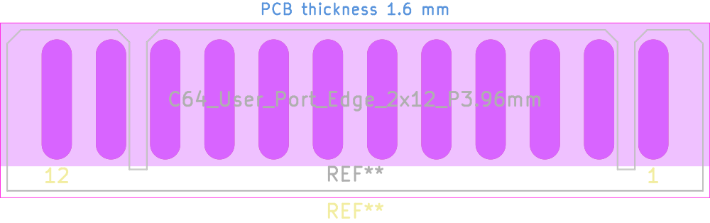
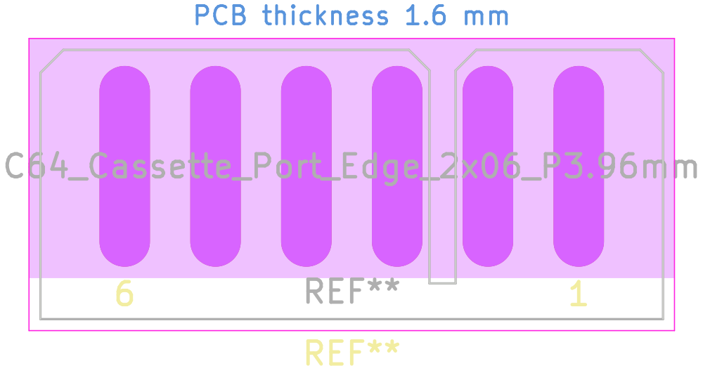

## Adding parts

- Use the KiCad 10 formats, not the legacy `.lib` format.
- Take footprints from the land pattern in the manufacturer's datasheet, and
  write down the source (document number and page) in the footprint
  description and in this README.
- Fill in the datasheet link, the description and the `LCSC Part #` field,
  the field name the main board uses.
- Check the pin numbers of the symbol against the footprint and the
  datasheet.
